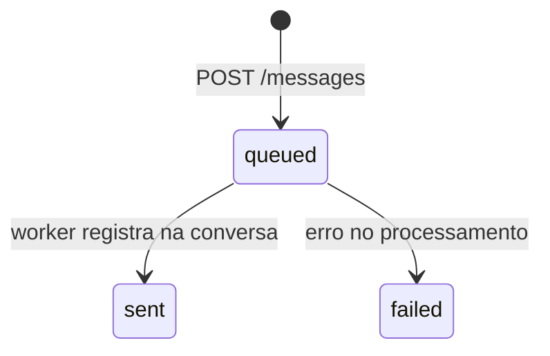
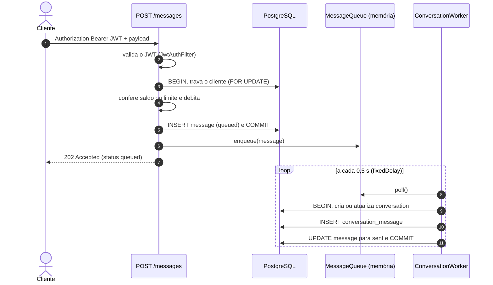
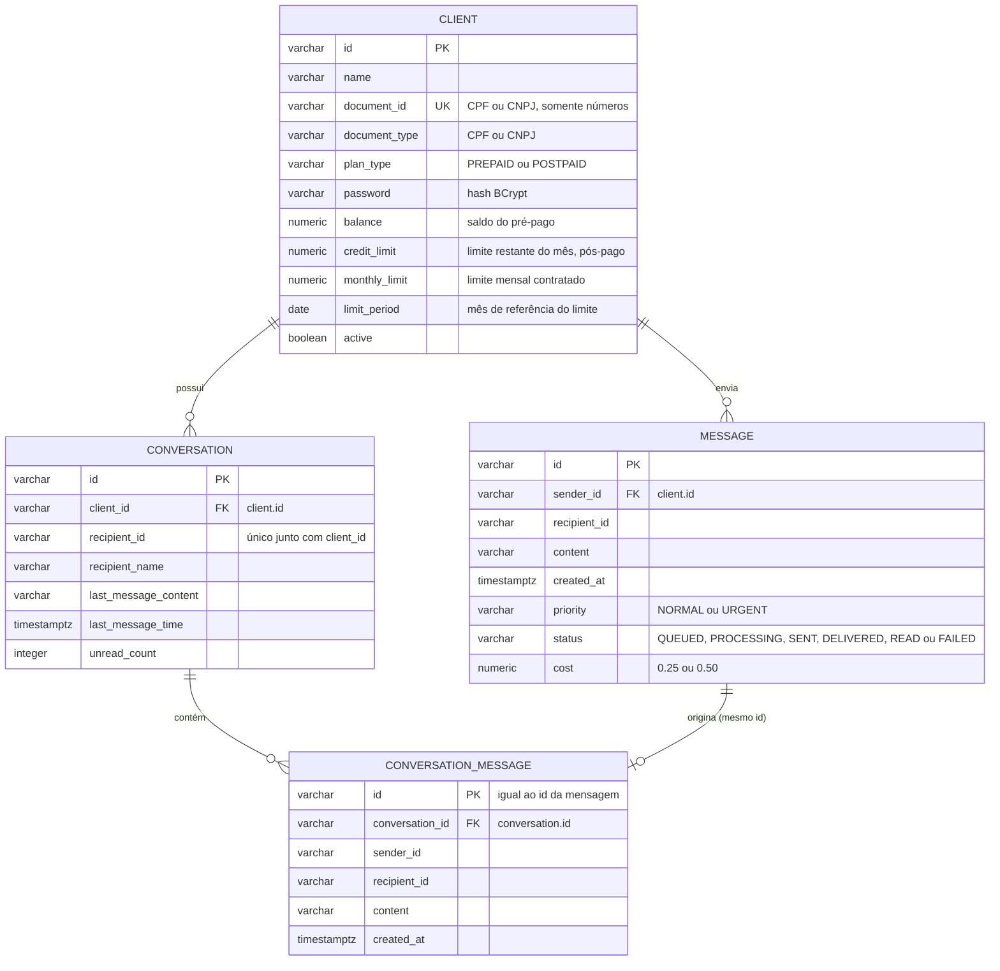

# BCB — Big Chat Brasil


API REST da plataforma **BCB (Big Chat Brasil)**, uma plataforma de chat para comunicação entre empresas e seus clientes finais, no estilo dos aplicativos de mensagens populares.

Repositório: <https://github.com/ducoral/bcb-api>

## Sumário

- [Visão geral](#visão-geral)
- [Regras de negócio](#regras-de-negócio)
- [Tecnologias](#tecnologias)
- [Pré-requisitos](#pré-requisitos)
- [Configuração](#configuração)
- [Como executar](#como-executar)
- [Autenticação](#autenticação)
- [Referência da API](#referência-da-api)
- [Fluxo de uma mensagem](#fluxo-de-uma-mensagem)
- [Modelo de dados](#modelo-de-dados)
- [Estrutura do projeto](#estrutura-do-projeto)
- [Testes e cobertura](#testes-e-cobertura)
- [Decisões de projeto](#decisões-de-projeto)

## Visão geral

O sistema oferece:

- Cadastro e administração de **empresas clientes** (pessoa física ou jurídica), com plano **pré-pago** ou **pós-pago**.
- **Envio de mensagens** com dois níveis de prioridade: `normal` (R$ 0,25) e `urgent` (R$ 0,50), com cobrança no momento do envio.
- Uma **fila de mensagens em memória**, consumida por um **worker em segundo plano** que alimenta as **conversas** de cada cliente com seus destinatários.
- **Autenticação por JWT** para os clientes e por token fixo para a administração.
- Documentação interativa da API (**Swagger UI**).

## Regras de negócio

### 1. Clientes e planos

- Clientes podem ser pessoa física (**CPF**, 11 dígitos) ou jurídica (**CNPJ**, 14 dígitos). O documento é único e deve conter apenas números.
- Cada cliente tem um plano (`prepaid` ou `postpaid`) e um status (**ativo/inativo**). Cliente inativo não consegue autenticar nem enviar mensagens.
- A senha do cliente é armazenada com hash **BCrypt** e nunca é devolvida pela API.

### 2. Envio de mensagens

- Uma mensagem contém: destinatário, texto e prioridade (`normal` ou `urgent`, padrão `normal`).
- O remetente é sempre o **cliente autenticado pelo JWT**, nunca um valor informado no corpo da requisição.
- Custo fixo por mensagem: **normal R$ 0,25** e **urgente R$ 0,50**.
- O sistema registra data/hora, status, custo e o cliente que solicitou.
- Ciclo de vida implementado:



Os status `processing`, `delivered` e `read` existem no modelo, mas ainda não têm transições.

### 3. Sistema de pagamento

A cobrança acontece **antes** de a mensagem entrar na fila, dentro de uma única transação de banco, com o cliente travado (`SELECT ... FOR UPDATE`). Isso impede que requisições simultâneas gastem o mesmo saldo duas vezes. Se a gravação da mensagem falhar, o débito é desfeito junto.

#### Pré-pago

- O cliente precisa ter **saldo suficiente** antes do envio.
- Validação: sistema verifica o saldo → debita o valor (`balance`) → grava a mensagem → enfileira.
- *Exemplo*: cliente com R$ 10,00 de saldo envia 5 mensagens normais (R$ 1,25) → saldo final: **R$ 8,75**.

#### Pós-pago

- O cliente tem um **limite mensal de consumo**, restaurado no início de cada mês (fuso `America/Sao_Paulo`).
- O campo `limit` guarda o **limite restante do mês**, e `monthlyLimit` guarda o **limite mensal contratado**.
- Validação: sistema verifica o limite → atualiza o limite restante (`limit`) → grava a mensagem → enfileira.
- *Exemplo*: cliente com limite de R$ 50/mês que já usou R$ 40 (restam R$ 10) envia 10 mensagens (R$ 2,50) → limite restante: **R$ 7,50**.
- A renovação mensal tem duas proteções: um job agendado (todo dia 1º, às 00:00) e uma renovação "preguiçosa" feita na primeira cobrança do mês, que cobre o caso de a aplicação estar fora do ar na virada.

Quando não há saldo ou limite suficiente, a API responde **402 Payment Required**, informando o valor necessário (`required`) e o disponível (`available`).

### 4. Administração

- Cadastrar, listar, consultar e atualizar clientes (`/admin/client`).
- Ajustar saldo (pré-pago), limite e limite mensal (pós-pago) pela atualização do cliente.
- Consultar saldo/limite de um cliente (`/admin/client/{id}/balance`).

### 5. Conversas

- Cada cliente tem **uma conversa por destinatário** (chave única `client_id` + `recipient_id`).
- O **consumo da fila de mensagens gera as conversas**: para cada mensagem retirada da fila, o worker cria a conversa (se ainda não existir) em `conversation` ou atualiza a existente (última mensagem, horário e contador de não lidas) e grava a mensagem em `conversation_message`.
- Todo o registro é idempotente: o `id` da mensagem da conversa é o mesmo `id` da mensagem original, e mensagens que já estão `sent` são ignoradas.

### 6. Priorização

- Hoje, todas as mensagens são processadas em ordem **FIFO**. A cada ciclo de processamento 
de 10 mensagens, 7 são mensagens com prioridade `urgent` para cada 3 mensagens com prioridade `normal` são
consumidas.

## Tecnologias

| Item | Detalhe |
|---|---|
| Linguagem | Java 25 |
| Framework | Spring Boot **4.2.0-SNAPSHOT** (Web MVC, Data JPA, Validation) |
| Build | Apache Maven 3.9.15 |
| Banco de dados | PostgreSQL, com migrations **Flyway** |
| Segurança | JWT (jjwt) e hash de senha BCrypt (`spring-security-crypto`) |
| Documentação | springdoc-openapi (Swagger UI) |
| Testes | JUnit, MockMvc, **Testcontainers** (PostgreSQL), Awaitility |

> O Spring Boot `4.2.0-SNAPSHOT` é publicado no repositório de snapshots do Spring (`https://repo.spring.io/snapshot`), já declarado no `pom.xml`. É necessário acesso à internet para baixar as dependências.

## Pré-requisitos

Devem estar instalados no computador:

- **Java 25** (JDK)
- **Apache Maven 3.9.15**
- **Docker** com o plugin Compose (para o `docker compose` e para os testes de integração, que usam Testcontainers)

Confira as versões:

```bash
java -version
mvn -v
docker --version
docker compose version
```

## Configuração

As propriedades ficam em `src/main/resources/application.properties` e podem ser sobrescritas por variáveis de ambiente.

| Propriedade | Obrigatória | Padrão | Descrição |
|---|---|---|---|
| `app.admin.token` | Sim, para a funcionalidade **Client Admin** | — | Token esperado no header `Authorization: Bearer <token>` dos endpoints `/admin/**`. |
| `app.jwt.secret` | Sim | — (definida pela variável `JWT_SECRET`) | Segredo de assinatura dos JWT (HS256). Mínimo de **32 caracteres**. |
| `app.jwt.ttl` | Não | `1h` | Validade do JWT. |
| `app.conversation-worker.enabled` | Não | `true` | Liga/desliga o worker que consome a fila. |
| `app.conversation-worker.interval` | Não | `PT0.5S` | Intervalo entre execuções do worker (ISO-8601). |

A funcionalidade **Client Admin** só funciona com a propriedade `app.admin.token` definida:

```properties
app.admin.token=admin-token
app.jwt.secret=${JWT_SECRET}
```

> **Atenção:** `admin-token` é um valor de desenvolvimento. Em qualquer ambiente real, use um token longo e aleatório, e gere o segredo do JWT com, por exemplo, `openssl rand -base64 48`.

As credenciais do PostgreSQL usadas pela aplicação (`spring.datasource.*`) devem corresponder às definidas no `docker-compose.yml`.

## Como executar

### 1. Clonar o repositório

```bash
git clone https://github.com/ducoral/bcb-api.git
cd bcb-api
```

### 2. Subir a infraestrutura com Docker Compose

O arquivo `docker-compose.yml`, na raiz do projeto, define a infraestrutura de apoio (banco PostgreSQL).

```bash
docker compose up -d        # sobe em segundo plano
docker compose logs -f      # acompanha os logs
docker compose down         # para os serviços
docker compose down -v      # para e apaga os volumes (zera o banco)
```

Se preferir ver os logs no terminal, rode `docker compose up` sem o `-d`.

### 3. Executar a aplicação

```bash
export JWT_SECRET="troque-por-um-segredo-com-mais-de-32-caracteres"

mvn spring-boot:run
```

Com a aplicação no ar (porta `8080` por padrão):

| Recurso | URL |
|---|---|
| Swagger UI | <http://localhost:8080/swagger-ui/index.html> |
| OpenAPI (JSON) | <http://localhost:8080/v3/api-docs> |

As migrations do Flyway são aplicadas automaticamente na inicialização.

### 4. Gerar o pacote

```bash
mvn clean package
java -jar target/bcp-0.0.1-SNAPSHOT.jar
```

## Autenticação

A API tem **dois mecanismos**, um para cada tipo de usuário:

| Escopo | Rotas | Credencial |
|---|---|---|
| Administração | `/admin/**` | `Authorization: Bearer <app.admin.token>` |
| Cliente | `/messages/**` e `/conversations/**` | `Authorization: Bearer <JWT>` obtido em `POST /auth/login` |
| Público | `/auth/login`, Swagger UI, `/v3/api-docs` | — |

Detalhes do JWT:

- Assinatura HS256, com `jti` único por token e validade configurável (`app.jwt.ttl`).
- Os tokens emitidos ficam registrados em um **store em memória**. Um token só é aceito se a assinatura for válida, não tiver expirado e ainda estiver no store (permite revogação). Reiniciar a aplicação invalida todos os tokens.
- Um cliente só enxerga os **próprios** recursos. Mensagem ou conversa de outro cliente responde **404**, e não 403, para não revelar que o id existe.

### Exemplo completo (curl)

```bash
# 1. Cadastrar um cliente (administração)
curl -X POST http://localhost:8080/admin/client \
  -H "Authorization: Bearer admin-token" \
  -H "Content-Type: application/json" \
  -d '{
    "id": "client123",
    "name": "Empresa ABC Ltda",
    "password": "senha123",
    "documentId": "12345678000199",
    "documentType": "CNPJ",
    "planType": "prepaid",
    "balance": 10.00,
    "limit": 0,
    "active": true
  }'

# 2. Autenticar o cliente e guardar o JWT
TOKEN=$(curl -s -X POST http://localhost:8080/auth/login \
  -H "Content-Type: application/json" \
  -d '{"id": "client123", "password": "senha123"}' | jq -r .accessToken)

# 3. Enviar uma mensagem
curl -X POST http://localhost:8080/messages \
  -H "Authorization: Bearer $TOKEN" \
  -H "Content-Type: application/json" \
  -d '{"recipientId": "user789", "content": "Olá, como vai?", "priority": "normal"}'

# 4. Consultar as conversas e as mensagens da conversa
curl -H "Authorization: Bearer $TOKEN" http://localhost:8080/conversations
curl -H "Authorization: Bearer $TOKEN" http://localhost:8080/conversations/{id}/messages
```

## Referência da API

### Endpoints

| Método | Rota | Descrição | Autenticação |
|---|---|---|---|
| `POST` | `/auth/login` | Autentica o cliente (`id` + `password`) e devolve um JWT | — |
| `POST` | `/admin/client` | Cadastra um cliente | Admin |
| `GET` | `/admin/client` | Lista clientes | Admin |
| `GET` | `/admin/client/{id}` | Detalhes de um cliente | Admin |
| `PUT` | `/admin/client/{id}` | Atualiza um cliente | Admin |
| `GET` | `/admin/client/{id}/balance` | Saldo, limite restante e limite mensal | Admin |
| `POST` | `/messages` | Envia uma mensagem (cobra, persiste e enfileira) | JWT |
| `GET` | `/messages` | Lista as mensagens do cliente, com filtros e paginação | JWT |
| `GET` | `/messages/{id}` | Detalhes de uma mensagem | JWT |
| `GET` | `/messages/{id}/status` | Status de uma mensagem | JWT |
| `GET` | `/conversations` | Lista as conversas do cliente | JWT |
| `GET` | `/conversations/{id}` | Detalhes de uma conversa | JWT |
| `GET` | `/conversations/{id}/messages` | Mensagens de uma conversa | JWT |

### Filtros de `GET /messages`

| Parâmetro | Descrição |
|---|---|
| `status` | `queued`, `processing`, `sent`, `delivered`, `read` ou `failed` |
| `priority` | `normal` ou `urgent` |
| `recipientId` | Id do destinatário |
| `from` / `to` | Período, em ISO-8601 (ex.: `2026-11-15T00:00:00Z`), ambos inclusivos |
| `page` | Número da página, começando em `0` (padrão `0`) |
| `size` | Itens por página, de `1` a `100` (padrão `20`) |

As listagens de mensagens e de conversas retornam as **mais recentes primeiro**, em um envelope de paginação:

```json
{
  "items": [ ],
  "page": 0,
  "size": 20,
  "totalElements": 42,
  "totalPages": 3
}
```

### Exemplos de payload

**Mensagem** (`POST /messages` → `202 Accepted`):

```json
{
  "id": "msg-3f2a...",
  "senderId": "client123",
  "recipientId": "user789",
  "content": "Olá, como vai?",
  "timestamp": "2026-11-15T10:30:00Z",
  "priority": "normal",
  "status": "queued",
  "cost": 0.25
}
```

**Conversa** (`GET /conversations/{id}`):

```json
{
  "id": "conv-91bc...",
  "clientId": "client123",
  "recipientId": "user789",
  "recipientName": null,
  "lastMessageContent": "Olá, como vai?",
  "lastMessageTime": "2026-11-15T10:30:00Z",
  "unreadCount": 1
}
```

**Mensagem da conversa** (`GET /conversations/{id}/messages`):

```json
{
  "id": "msg-3f2a...",
  "conversationId": "conv-91bc...",
  "senderId": "client123",
  "recipientId": "user789",
  "content": "Olá, como vai?",
  "timestamp": "2026-11-15T10:30:00Z"
}
```

### Códigos de resposta

| Código | Significado |
|---|---|
| `200` | Sucesso |
| `201` | Cliente criado |
| `202` | Mensagem aceita: persistida e enfileirada para processamento |
| `400` | Dados inválidos (validação, filtro ou paginação) |
| `401` | Credenciais, token ausente, inválido, expirado ou revogado |
| `402` | Saldo (pré-pago) ou limite mensal (pós-pago) insuficiente |
| `403` | Cliente inativo |
| `404` | Recurso não encontrado (inclui recursos de outro cliente) |
| `409` | Conflito: `id` ou documento já cadastrado |

Os erros seguem o formato `application/problem+json` (RFC 7807). Erros de validação trazem um mapa `errors` com os campos rejeitados.

## Fluxo de uma mensagem



Pontos importantes:

- **A mensagem só entra na fila depois do commit.** Nunca existe mensagem na fila sem a cobrança confirmada.
- **Recuperação após reinício:** como a fila é em memória, uma rotina de inicialização recarrega as mensagens com status `queued` do banco. Mensagens já processadas ficam `sent` e não voltam.
- **Cada mensagem é processada em uma transação própria** (conversa, mensagem da conversa e status mudam juntos). Se o processamento falhar, a mensagem é marcada como `failed` e o erro é registrado em log.
- O consumo da fila é registrado em **logs `INFO`**: mensagem enfileirada, retirada da fila, conversa criada ou atualizada, e um resumo por ciclo de consumo (processadas, ignoradas, falhas e tempo). O conteúdo das mensagens **não** é logado.

## Modelo de dados

O esquema é criado pela migration `src/main/resources/db/migration/V1__create-tables.sql`.



| Tabela | Descrição | Restrições principais |
|---|---|---|
| `client` | Empresas clientes, plano e saldo/limite | `document_id` único; saldo e limites `>= 0`; documento coerente com o tipo (11 ou 14 dígitos) |
| `message` | Mensagens enviadas, com custo e status | FK para `client`; `priority` e `status` restritos aos valores válidos; `cost >= 0`; índice parcial sobre mensagens `QUEUED` |
| `conversation` | Uma conversa por par cliente/destinatário | FK para `client`; único `(client_id, recipient_id)`; `unread_count >= 0`; índice por `(client_id, last_message_time)` |
| `conversation_message` | Mensagens que compõem cada conversa | FK para `conversation`; índice por `(conversation_id, created_at)` |

## Estrutura do projeto

O projeto é organizado **por funcionalidade** (*package by feature*). Dentro de cada uma, o subpacote `web` guarda apenas o que é específico de HTTP (controllers e DTOs).

```
src/main/java/du/coral/bcb/
├── BcpApplication.java
├── auth/            # login, JWT, store de tokens em memória, filtro de autenticação
│   └── web/
├── billing/         # relógio de cobrança e job de renovação do limite mensal
├── client/          # entidade Client, regras de cobrança, repositório e serviço
│   └── web/         # /admin/client
├── conversation/    # Conversation, ConversationMessage, worker e serviço de leitura
│   └── web/         # /conversations
├── message/         # Message, MessageQueue, envio, carga inicial da fila
│   └── web/         # /messages
└── shared/
    ├── config/      # OpenAPI/Swagger e demais configurações
    └── error/       # tratamento global de erros

src/main/resources/
├── application.properties
└── db/migration/    # migrations Flyway

src/test/java/du/coral/bcb/   # testes de integração (*IT)
docker-compose.yml
```

## Testes e cobertura

Os testes de integração (classes `*IT`) sobem um **PostgreSQL real** com Testcontainers, aplicam as migrations do Flyway e chamam a API por MockMvc. O Docker precisa estar em execução.

```bash
mvn clean verify                          # testes unitários (surefire) e de integração (failsafe)
mvn verify -Dit.test=MessageIT            # apenas uma classe de integração
mvn test                                  # apenas testes unitários
```

Classes de integração: `ClientAdminControllerIT`, `AuthIT`, `MessageIT`, `ConversationIT` e `ConversationWorkerIT` (esta última com o worker ligado, usando Awaitility).

### Cobertura

Relatório gerado em **17/11/2026 às 14:38**, com o IntelliJ IDEA (*Run with Coverage*), escopo *all classes*.

| Pacote | Classes | Métodos | Branches | Linhas |
|---|---:|---:|---:|---:|
| **Total** | **100%** | **91,7%** | **82,4%** | **93%** |
| `du.coral.bcb` | 100% | 50% | — | 50% |
| `du.coral.bcb.auth` | 100% | 100% | 75% | 94,4% |
| `du.coral.bcb.auth.web` | 100% | 100% | — | 100% |
| `du.coral.bcb.billing` | 100% | 100% | — | 100% |
| `du.coral.bcb.client` | 100% | 73,2% | 83,3% | 78,4% |
| `du.coral.bcb.client.web` | 100% | 85,7% | 75% | 94% |
| `du.coral.bcb.conversation` | 100% | 91,7% | 87,5% | 91,4% |
| `du.coral.bcb.conversation.web` | 100% | 100% | — | 100% |
| `du.coral.bcb.message` | 100% | 98,4% | 97,2% | 99,4% |
| `du.coral.bcb.message.web` | 100% | 100% | 70% | 95,5% |
| `du.coral.bcb.shared.config` | 100% | 100% | — | 100% |
| `du.coral.bcb.shared.error` | 100% | 100% | 50% | 96,8% |

Valores absolutos do total: 60/60 classes, 222/242 métodos, 122/148 branches e 612/658 linhas. O traço (—) indica pacote sem *branches*.

Para gerar o relatório novamente no IntelliJ IDEA: **Run → Run 'All Tests' with Coverage** e, na janela *Coverage*, **Generate Coverage Report**.

## Decisões de projeto

- **Fila em memória:** `MessageQueue` é um *singleton* com uma fila FIFO thread-safe. A durabilidade vem do banco: toda mensagem é gravada antes de entrar na fila e recarregada na inicialização se ainda estiver `queued`.
- **Worker com `fixedDelay`:** o consumo roda em uma única thread, sem sobreposição de execuções, preservando a ordem de chegada. O processamento fica em `ConversationFeeder` (testável chamando `drain()`) e o agendamento em `ConversationWorker`, que pode ser desligado por propriedade.
- **Cobrança consistente:** débito e gravação da mensagem na mesma transação, com trava pessimista no cliente. Os `CHECK` do banco (saldo e limite `>= 0`) funcionam como rede de segurança.
- **Segurança por escopo:** o remetente vem do JWT, e todos os recursos de leitura são filtrados pelo cliente autenticado.
- **Aceitação assíncrona:** `POST /messages` responde `202`, porque a mensagem foi aceita e persistida, mas ainda será processada pelo worker.
- **Enums em minúsculas no JSON** de mensagens (`normal`, `queued`...), inclusive nos filtros da query string.
- **Falhas de validação** de paginação e filtros respondem `400` pelo tratamento padrão do Spring.

